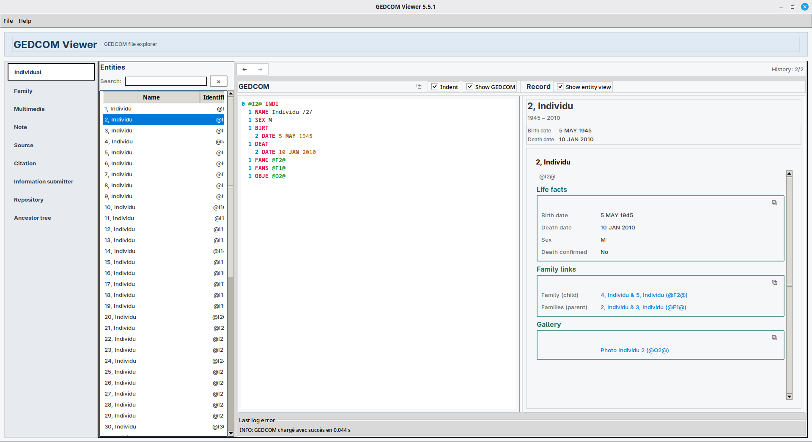

# GEDCOM Viewer 5.5.1



GEDCOM Viewer est une application de bureau Python/Tkinter pour lire et explorer
des fichiers GEDCOM 5.5.1. Elle est strictement en lecture seule : les fichiers
ne sont ni modifiés ni sauvegardés.

## Fonctionnalités

- Ouverture de fichiers `.ged` et affichage des entités `INDI`, `FAM`, `SOUR`,
  `REPO`, `NOTE`, `OBJE`, `SUBM` et des citations `CITE`.
- Recherche filtrée, insensible à la casse et aux accents.
- Navigation par pointeurs GEDCOM et historique précédent/suivant.
- Fiches détaillées, liens cliquables, notes, événements, sources et galerie
  multimédia.
- Aperçu des images locales et de la première page des PDF lorsque les
  dépendances sont disponibles.
- Bloc GEDCOM brut avec coloration syntaxique, indentation optionnelle et copie.
- Chargement asynchrone, fichiers récents, thèmes clair/sombre et interface
  multilingue.

## Démarrage rapide

Prérequis : Python 3.11 ou plus récent, Tkinter et `make`.

```bash
make run
```

Après installation des dépendances, l'application peut aussi être lancée avec :

```bash
.venv/bin/python main.py
```

Les prérequis système, les dépendances et les variantes de lancement sont
détaillés dans [Installation](docs/INSTALLATION.md).

## Documentation

- [Installation](docs/INSTALLATION.md) — prérequis, dépendances et lancement.
- [Utilisation](docs/USAGE.md) — interface, navigation, recherche et vues.
- [Formats et limites](docs/FORMATS.md) — lecture, encodage et validation GEDCOM.
- [Préférences](docs/PREFERENCES.md) — données conservées par l'application.
- [Tests](docs/TESTS.md) — organisation, commandes et couverture.
- [Benchmarks](docs/BENCHMARKS.md) — mesures de performance et de mémoire.
- [Développement](docs/DEVELOPPEMENT.md) — commandes et outillage.
- [Build](docs/BUILD.md) — construction de l'exécutable autonome.
- [CI](docs/CI.md) — pipeline d'intégration continue.
- [Architecture](docs/ARCHITECTURE.md) — couches et structure du dépôt.
- [Arbre d'ascendance](docs/ARBRE_ASCENDANCE.md) — spécifications UI et comportement du clic.
- [MVP](docs/MVP.md), [Parcours MVP](docs/MVP-REQUEST.md),
  [Modèle de domaine](docs/DOMAIN-MODEL.md),
  [Chargement asynchrone](docs/ASYNC-LOADING.md).

## Licence

Projet distribué sous licence MIT. Voir [LICENSE](LICENSE).
