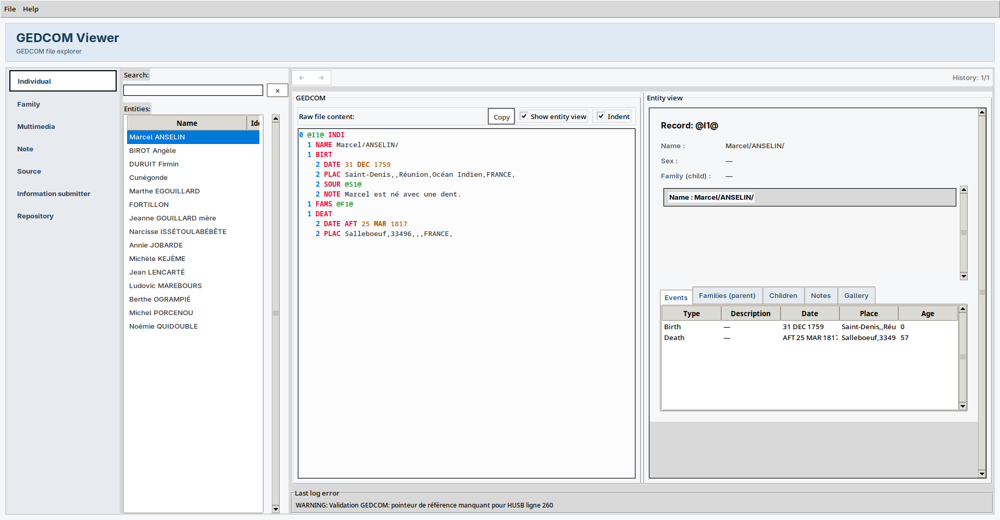

# GEDCOM Viewer 5.5.1



GEDCOM Viewer est une application de bureau Python/Tkinter pour ouvrir et explorer des fichiers GEDCOM.

## Documentation

Le dépôt conserve une documentation minimale et ciblée :

- [README.md](README.md) : vue d’ensemble, installation, lancement, tests et utilisation quotidienne.
- [docs/architecture.md](docs/architecture.md) : description technique de l’architecture, des flux et des composants.
- [docs/analysis.md](docs/analysis.md) : analyse du projet, limites connues, points de vigilance et recommandations.
- [docs/roadmap.md](docs/roadmap.md) : priorités d’évolution et plan de refonte / consolidation.

## Fonctionnalités

- Ouverture de fichiers GEDCOM `.ged`.
- Deux modes d'ouverture : tolérant ou strict avec validation structurelle.
- Liste des entités par type : `INDI`, `FAM`, `SOUR`, `REPO`, `NOTE`, `OBJE` et `SUBM`.
- Recherche réactive dans les entités avec debounce pour limiter les recalculs.
- Bouton d'effacement rapide du filtre de recherche.
- Bouton d'effacement intégré à la palette visuelle de l'application.
- Tri par nom, titre ou identifiant, avec tri numérique des pointeurs.
- Navigation entre les pointeurs GEDCOM tels que `@I1@` ou `@F1@`.
- Historique de navigation précédent/suivant.
- Affichage du bloc GEDCOM brut avec coloration syntaxique.
- Affichage des blocs `HEAD` et `TRLR`.
- Gestion des fichiers récemment ouverts.
- Vues détaillées pour les individus, familles, sources, dépôts, notes, médias et submitters.
- Formulaire Individu avec onglets « Familles (parent) » (liste à deux colonnes
  nom/identifiant) et « Enfants ».
- Panneau de détail (bloc GEDCOM brut / formulaire d'entité) redimensionnable
  via un séparateur déplaçable.
- Prévisualisation des images locales dans l'onglet multimédia avec Pillow.
- Chargement des fichiers en arrière-plan afin de maintenir l'interface réactive,
  avec publication atomique du contrôleur après succès.
- Conservation de l'état chargé en cas d'échec et arrêt propre du polling lors de
  la fermeture de la fenêtre.
- Journalisation dans `~/.gedcom_viewer.log`.
- Affichage du temps de chargement dans la barre de statut.
- Signalement dans le journal des lignes malformées et des caractères remplacés lors de la lecture.
- Préservation des espaces répétés à l’intérieur des valeurs GEDCOM.
- Validation structurelle et cohérence des types de références GEDCOM reconnues
  disponibles en mode strict via `load(..., strict=True)`, y compris le rejet des
  pointeurs mal formés ou manquants pour les tags qui exigent une référence et
  les contextes invalides pour les références GEDCOM reconnues, ainsi que les
  pointeurs requis des enregistrements indexés.
- Infrastructure d'internationalisation avec l'anglais comme langue par défaut.
- Interface disponible en anglais, français, espagnol, allemand, italien et portugais.
- Le changement de langue est appliqué au redémarrage.

L'application est en lecture seule : elle n'édite ni ne sauvegarde les fichiers GEDCOM.

## Champs utilisés par la recherche

La recherche porte sur les champs GEDCOM suivants :

| Type | Champs recherchés |
| --- | --- |
| `INDI` | Pointeur de l'individu et `NAME` |
| `FAM` | Pointeur de la famille et `NAME` des individus référencés par `HUSB`, `WIFE` ou `CHIL` |
| `SOUR` | Pointeur de la source et `TITL` |
| `REPO` | Pointeur du dépôt et `NAME` |
| `NOTE` | Pointeur de la note et texte de la note |
| `OBJE` | Pointeur du média, `TITL` et `FILE` |
| `SUBM` | Pointeur du submitter, `NAME` et `EMAIL` |

La recherche est insensible à la casse et aux accents pour tous ces champs :
`cretel` trouve notamment `crétel`, `Crétel` et `Cretel`, quel que soit le type
d'entité recherché.

## Architecture

```text
UI Tkinter (ui/)
  -> contrôleurs (controllers/) [thread principal]
        -> service GEDCOM
            -> parser et modèles métier (gedcom/)
```

Le chargement et la construction des modèles sont exécutés dans un thread de
travail. Les résultats et les erreurs sont ensuite appliqués à l'interface dans
le thread Tkinter principal.

- `gedcom/` contient le parser et les modèles métier.
- `controllers/` coordonne le chargement, la recherche, le tri et la résolution des pointeurs.
- `ui/` contient la fenêtre principale, les menus, le thème et les vues spécialisées.
- `ui/i18n.py` charge les traductions depuis les catalogues JSON de `ui/locales/`.
- `tests/` contient les tests unitaires et les tests UI Tkinter.

## Prérequis

- Python 3.x
- Tkinter
- Accès à `pip` pour installer Pillow, PyInstaller et Black

Sur Debian ou Ubuntu, Tkinter peut être installé avec :

```bash
sudo apt install python3-tk
```

## Installation

Le `Makefile` crée automatiquement `.venv` si nécessaire et installe les outils requis :

```bash
make install
```

Cette commande installe :

- Pillow pour la prévisualisation des images ;
- PyInstaller pour la génération de l'exécutable ;
- Black pour le formatage du code.

Les dépendances runtime sont listées dans `requirements.txt` et les outils de
développement dans `requirements-dev.txt`. La cible `make run` vérifie
l'environnement virtuel et installe ou met à jour les dépendances avant le
lancement.

## Lancement

Avec le script fourni :

```bash
./run.sh
```

Ou directement avec Python :

```bash
python3 main.py
```

Avec l'environnement virtuel du projet :

```bash
.venv/bin/python main.py
```

Au démarrage, l'application tente de recharger le dernier fichier GEDCOM récent lorsqu'il existe encore.

Dans le menu `Fichier`, `Ouvrir un fichier GEDCOM` conserve le mode tolérant.
`Ouvrir et valider un fichier GEDCOM` utilise le mode strict et refuse les
anomalies détectées, notamment les erreurs structurelles et certaines références
inconnues ou incompatibles. Les fichiers récents sont rechargés en mode tolérant.

## Tests et vérifications

Exécuter les tests :

```bash
make test
```

Ou directement :

```bash
.venv/bin/python -m unittest discover -s tests
```

Dernière validation locale : 175 tests passent dans la suite complète.

Mesurer le chargement, la mémoire et la recherche sur des fichiers synthétiques :

```bash
python3 benchmarks/benchmark_search.py
```

Les tailles par défaut sont 10 000, 50 000 et 100 000 individus. Le benchmark
compare la normalisation Unicode complète à chaque requête au fast path ASCII.
L’option `--families` ajoute des familles liées aux individus pour mesurer aussi
leur coût mémoire, par exemple :

```bash
python3 benchmarks/benchmark_search.py --sizes 100000 --families 50000 --repeats 1
```

L’option `--other-entities` ajoute ce nombre d’enregistrements pour chacun des
types `NOTE`, `SOUR`, `REPO`, `SUBM` et `OBJE`; `--events-per-family` ajoute des
événements `MARR` sans sous-tags à chaque famille. L’option
`--events-per-source` ajoute des événements `DATA/EVEN` à chaque source créée
par `--other-entities`, par exemple :

```bash
python3 benchmarks/benchmark_search.py --sizes 10000 --other-entities 10000 --events-per-source 2 --repeats 1
```
Le benchmark mesure la mémoire conservée après le chargement, puis l’allocation
supplémentaire quand les données optionnelles sont toutes consultées.
L’option `--texts-per-individual` ajoute des tags `TEXT` avec continuation à
chaque individu afin de mesurer les données textuelles différées :

```bash
python3 benchmarks/benchmark_search.py --sizes 100000 --texts-per-individual 2 --repeats 1
```
Les options `--occupations-per-individual` et `--properties-per-individual`
ajoutent respectivement des événements `OCCU` datés et des tags `PROP` à chaque
individu pour mesurer ces listes différées :

```bash
python3 benchmarks/benchmark_search.py --sizes 100000 --occupations-per-individual 2 --properties-per-individual 1 --repeats 1
```
`--notes-per-individual` ajoute des notes `NOTE` avec continuation, par exemple :

```bash
python3 benchmarks/benchmark_search.py --sizes 100000 --notes-per-individual 2 --repeats 1
```
`--fams-per-individual` et `--obje-per-individual` ajoutent des références aux
familles et médias synthétiques; ils nécessitent respectivement `--families` et
`--other-entities` :

```bash
python3 benchmarks/benchmark_search.py --sizes 100000 --families 50000 --other-entities 50000 --fams-per-individual 1 --obje-per-individual 1 --repeats 1
```

Vérifier la syntaxe Python :

```bash
make lint
```

Formater le code avec Black :

```bash
make format
```

## Génération de l'exécutable

Créer une version autonome avec PyInstaller :

```bash
make dist
```

L'exécutable est généré dans :

```text
dist/gedcom_viewer
```

Nettoyer les artefacts de build et l'environnement virtuel :

```bash
make clean
```

Cette commande supprime `build/`, `dist/`, `.venv/` et les répertoires `__pycache__/`.

## Fichiers utilisateur

Les journaux sont écrits dans :

```text
~/.gedcom_viewer.log
```

Les préférences, le répertoire du dernier GEDCOM chargé et la liste des fichiers
récents sont enregistrés dans :

```text
~/.gedcom_viewer.json
```

## Limites connues

- Les gros fichiers sont toujours chargés entièrement en mémoire. Sur le jeu synthétique de 100 000 individus du benchmark, les arbres d’événements et les listes optionnelles des individus sont construits à la demande; `Individual` utilise des slots. Le pic mesuré est de 67,3 MiB, contre 99,3 MiB auparavant. Des mesures synthétiques séparées de 50 000 familles, sources, notes, dépôts et submitters épars donnent respectivement 19,6 MiB (contre 41,0), 16,5 MiB (contre 32,5), 13,6 MiB (contre 26,5), 15,2 MiB (contre 25,9) et 12,2 MiB (contre 19,9) après slots et listes paresseuses. Cent mille objets `Event` sans détails passent de 15,3 à 6,1 MiB avec slots et détails paresseux; 50 000 objets multimédias passent de 15,7 à 13,8 MiB avec slots. Avec `--families 50000`, le jeu combiné de 100 000 individus et 50 000 familles mesure 103,4 MiB. Ces mesures dépendent de l’environnement; les lignes brutes restent chargées intégralement.
- Les événements familiaux sont représentés par le modèle `Event`, mais leur structure reste volontairement simple : un tag, une valeur et une liste de sous-tags.
- Les événements de mariage multiples sont affichés dans la vue famille, mais ne disposent pas encore d'une présentation détaillée dédiée.
- Le parser signale les anomalies, mais ne réalise pas une validation complète de conformité GEDCOM.
- L'ouverture standard reste tolérante ; le mode strict est également accessible dans le menu `Fichier` et via l'API Python.

## Structure du projet

```text
.
├── controllers/
├── gedcom/
│   └── models/
├── ui/
│   └── views/
├── tests/
├── main.py
├── Makefile
├── gedcom_viewer.spec
└── run.sh
```

## Licence et contributions

Aucun fichier de licence n'est fourni dans le dépôt. Les contributions peuvent être proposées via une branche dédiée et une pull request, accompagnées de tests pour les changements de comportement.
