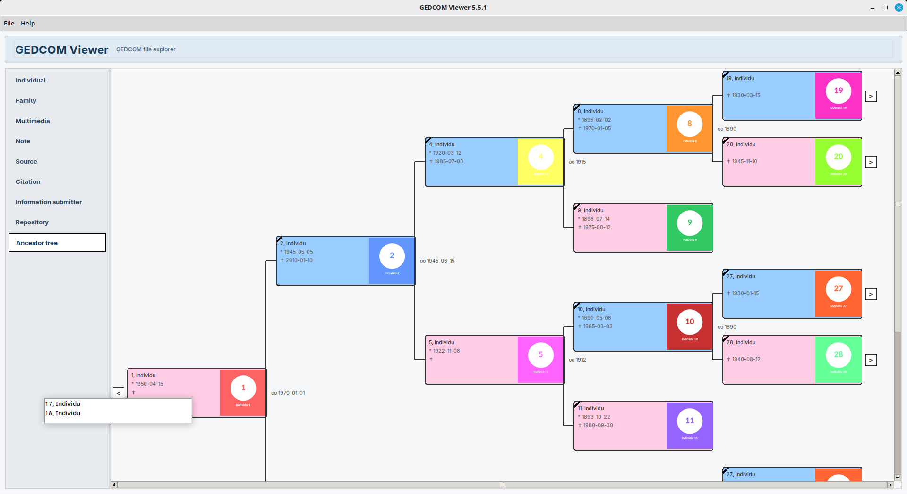

# Arbre d'ascendance

## Capture d'écran



L'arbre d'ascendance affiche, pour un individu donné, ses ancêtres sur
cinq générations à la fois dans un canvas horizontal défilable. L'arbre
interne est construit sur la profondeur complète du GEDCOM (jusqu'à 50
générations) ; seuls les cinq premières sont visibles. Chaque génération
est décalée vers la gauche ; les parents d'un nœud se trouvent à sa
gauche.

## Bouton ">"

À droite de chaque boîte de la **cinquième génération visible** qui
possède encore un parent, un petit bouton carré contenant le caractère
`>` s'affiche. Un clic sur ce bouton décale l'arbre d'une génération vers
la gauche pour révéler la génération suivante d'ancêtres, sans changer de
racine. Le bouton n'apparaît que sur les nœuds de la dernière génération
affichée qui ont au moins un parent.

## Bouton "<" enfants

À gauche du **nœud racine** quand celui-ci a au moins un enfant, un
petit bouton carré contenant le caractère `<` s'affiche. Un clic sur ce
bouton ouvre une petite fenêtre sans bordure, positionnée juste sous et
centrée horizontalement sur le bouton, qui liste tous les enfants de la
racine (via les liens FAMC). Cliquer sur un enfant recentre l'arbre sur
lui et ferme la fenêtre ; la fenêtre se ferme aussi quand le focus est
perdu ou à la sélection d'un enfant.

## Comportement d'un clic sur un nœud

Un clic sur un individu de l'arbre déclenche trois actions, et aucune de
plus :

1. **Sélection** : l'individu cliqué devient l'individu courant
   (`_current_entity`) et est mémorisé dans le coordinateur de sélection
   pour le type INDI. Ainsi, quand l'utilisateur bascule ensuite vers le
   type d'entité Individu, cet individu est affiché dans la vue détaillée.
   Le type d'entité affiché reste cependant "Ancestor tree" (pas de bascule
   immédiate).
2. **Recentrage** : l'arbre est reconstruit avec cet individu en racine
   (génération 0) ; il devient la tête de pyramide.
3. **Pas de bascule de vue** : la vue individuelle détaillée n'est pas
   affichée ; l'utilisateur reste dans l'onglet arbre d'ascendance.

Ce comportement est implémenté dans
`ui/main_window.py:_on_ancestor_individual_clicked` et invoqué par le
callback `on_individual_selected` de `AncestorTreeView`.

## Basculement vers le type Individu

Quand l'utilisateur bascule du type "Ancestor tree" vers le type
"Individu" (via le panneau de types à gauche), l'individu qui était
sélectionné dans l'arbre est restauré comme sélectionné dans le
coordinateur (`EntitySelectionCoordinator.remember_selection` avec le
type "INDI"), et s'affiche donc dans la vue détaillée Individu.
Ainsi, la navigation dans l'arbre prépare le contenu de la fiche Individu
sans basculer de vue immédiatement.

## Spécifications de l'interface

- **Taille d'un nœud** : `NODE_WIDTH = 295`, `NODE_HEIGHT = 104` pixels.
- **Espacement horizontal** : `HORIZONTAL_SPACING = 315` entre deux frères.
- **Profondeur construite** : jusqu'à 50 générations (`MAX_GENERATIONS =
  50` dans `AncestorTreeService`).
- **Générations visibles** : 5 à la fois depuis la racine.
- **Bouton ">"** : carré de 23×23 px à droite de chaque nœud de la
  cinquième génération visible qui possède encore un parent. Un clic
  décale l'arbre d'une génération vers la gauche (et non vers le nœud
  lui-même) pour révéler la génération suivante d'ancêtres.
- **Couleur de fond** : bleue pour un homme (`#99ccff`), rose pour une
  femme (`#ffcce5`), surface neutre sinon.
- **Témoin de décès** : barre oblique `/` en haut à gauche du cadre du
  nœud, touchant les bords haut et gauche ; appliquée à toutes les
  générations.
- **Photo** : lorsqu'un chemin de photo est défini, elle est affichée sur
  le tiers droit du nœud, justifiée à droite (touche le bord droit) et
  reprend la couleur de fond du sexe autour d'elle (pas de fond distinct,
  pas de bord blanc). Sans photo, tout le nœud garde la couleur du sexe.
- **Nom** : affiché sur une seule ligne (pas de retour à la ligne). S'il
  dépasse l'espace disponible, les derniers prénoms sont supprimés un par
  un jusqu'à ce qu'il tienne, suivi de points de suspension (`…`).
- **Dates de naissance et décès** : affichées sous le nom avec les
  symboles `*` et `✝`. Si la date est absente, seul le symbole s'affiche.
  La date de naissance et son symbole ne s'affichent pas à la cinquième
  génération visible. La date de décès et son symbole s'affichent à
  toutes les générations quand la date est connue.
- **Encadrement** : une seule bordure homogène autour du nœud
  (`width=2`) ; le rectangle cliquable n'a ni remplissage ni bordure.

## Régénérer la capture d'écran

La capture d'écran est prise manuellement depuis la fenêtre de l'application
(l'ancien script basé sur `canvas.postscript()` produisait un texte illisible).

Les scripts se trouvent dans `scripts/` :

- `lancer_pour_capture.sh` — génère un fichier GEDCOM de test en mémoire,
  puis lance GEDCOM Viewer. Vous ouvrez le fichier, allez dans l'onglet
  "Arbre d'ascendance", sélectionnez l'individu en racine et faites votre
  capture d'écran vous-même.

Pour régénérer :

```bash
./scripts/lancer_pour_capture.sh
```

Le script crée `/tmp/test_arbre_ascendance.ged` (56 individus, 27 familles,
56 objets multimédia — une photo par individu, noms génériques, dates de
naissance et décès, avec plusieurs 6ème générations et un époux/enfants pour
l'individu en racine)
et lance l'application. Une fois l'arbre affiché, prenez votre
capture d'écran et enregistrez-la dans `docs/screenshots/arbre_ascendance.png`.
