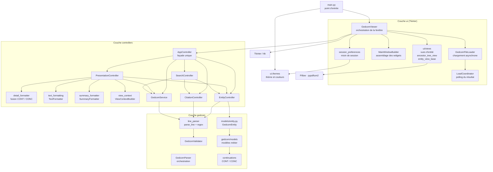

# Architecture en couches

Vue en couches du système : dépendances entre le point d'entrée, l'interface, les
contrôleurs et le domaine GEDCOM.



## Lecture

- Le point d'entrée `main()` applique le thème, désactive l'XIM IBus si besoin puis
  construit la fenêtre avant la boucle d'événements Tkinter.
- Les vues ne reçoivent que des fournisseurs (closures) vers l'`AppController` :
  elles ne connaissent aucun contrôleur concrètement, ce qui permet le
  remplacement de session.
- `AppController` est la façade unique utilisée par l'interface ; les contrôleurs
  spécialisés ne sont jamais instanciés par les vues.
- Les préférences de session (thème, langue, fichiers récents) vivent dans
  `ui/session_preferences.py`, injectées par mixin dans `GedcomViewer` : la
  fenêtre ne les implémente plus directement.
- Le re-thème à l'exécution passe par un registre par session
  (`ui/theme_aware.py`) : les composants exposant `apply_theme()` s'y
  enregistrent et sont réappliqués sans liste codée en dur.
- Le formatage des détails (fusion des continuations CONT/CONC) est assuré par
  `controllers/detail_formatter.py` (`merge_text_continuations`) et complété par
  `controllers/text_formatting.py` (`TextFormatter`),
  `controllers/summary_formatter.py` (`SummaryFormatter`) et
  `controllers/view_context.py` (`ViewContextBuilder`) : les vues
  déclarent un `details_formatter_resolver` injecté via `EntityViewBase` (résolu
  vers `AppController.format_details`), qui délègue à
  `PresentationController.format_details` lorsque présent ; celui-ci appelle
  directement le formateur.
- Le protocole des résolveurs (injection de fonctions de résolution de pointeurs
  et de formatage des détails) est défini dans le cartouche de
  `ui/views/entity_view_base.py` : `set_pointer_resolver`,
  `set_name_resolver`, `set_family_name_resolver`, `set_source_resolver`,
  `set_note_resolver`, `set_object_resolver`, `set_family_member_resolver`,
  `set_display_name_resolver`, `set_family_display_name_resolver`,
  `set_object_display_name_resolver` et `set_details_formatter_resolver`.
  Chaque résolveur absent ou non applicable renvoie ``None`` ; les vues
  retombent alors sur le pointeur brut.
- `CitationController` indexe les citations par propriétaire et par source ;
  `CITE` est une entité virtuelle (décrite dans `PresentationController`) dont
  le pointeur source résout vers l'enregistrement `SOUR` sous-jacent.
- Les fiches structurées délèguent la construction des sections, des lignes et des
  liens à des composants dédiés (`structured_section_builder`,
  `structured_row_factory`, `structured_link_renderer`) ; la vue conserve le
  rendu des événements et les libellés.
- La couche `gedcom` ignore les couches supérieures : la dépendance est
  descendante unique, du point d'entrée vers le domaine.

## Structure du dépôt

```text
.
├── benchmarks/   mesures de recherche et de mémoire
├── controllers/  orchestration, recherche, présentation de liste et types d'entité
├── docs/         documents d'architecture et d'exploitation (un sujet par fichier)
├── gedcom/       parsing, validation, continuations et modèles métier
├── tests/        tests unitaires et tests Tkinter
├── ui/           interface, vues, sélection d'entité et chargement de fichier
├── main.py       point d'entrée
└── Makefile      commandes de développement et de build
```

`controllers/entity_types.py` centralise les correspondances entre tags GEDCOM
et types de contexte. Les classes de fiches restent déclarées dans
`ui/entity_view_manager.py`. `gedcom/parser.py` délègue la validation à
`gedcom/validator.py` ; les règles partagées de `CONT`/`CONC` sont dans
`gedcom/continuations.py`.

`ui/gedcom_file_loader.py` coordonne les chargements asynchrones ; il délègue le
travail en arrière-plan à `ui/load_coordinator.py`. Un nouvel `AppController` est
publié dans Tkinter uniquement après succès. En cas d'erreur, la session courante
reste disponible et son état UI est restauré.

`ui/main_window_builder.py` assemble l'interface. `ui/detail_panel.py` porte le
panneau de détail, l'en-tête d'identité et la vue GEDCOM brute.

## Voir aussi

- [Fonctionnement MVP](MVP.md)
- [Modèle de domaine](DOMAIN-MODEL.md)
- [Chargement asynchrone](ASYNC-LOADING.md)
