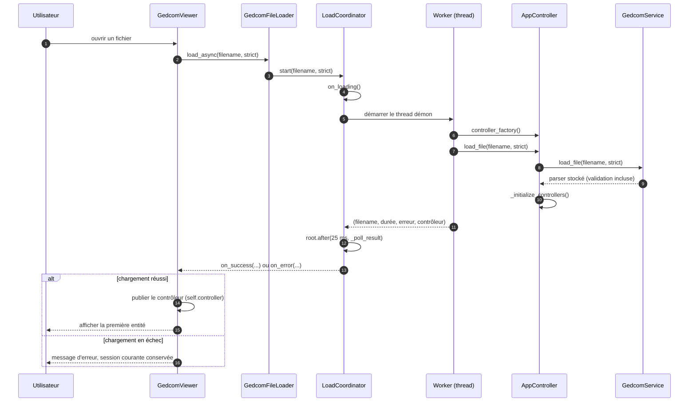

# Chargement asynchrone d'un fichier

Déroulé du chargement d'un fichier GEDCOM hors du thread Tkinter, puis
publication du contrôleur sur le thread de l'interface.

## Lecture

- Le travail de lecture et de validation s'effectue dans un thread démon ; seuls
  le polling et les callbacks s'exécutent sur le thread de l'interface.
- Le résultat est déposé dans une file ; `_poll_result` se replanifie toutes les
  25 ms tant que la file est vide, puis traite le premier résultat disponible.
- Un jeton de chargement identifie chaque résultat; après `cancel()`, `close()` ou
  un délai dépassé, les résultats obsolètes sont ignorés. Le délai par défaut est
  de 120 s et peut être ajusté via `start(..., timeout=...)`.
- `cancel()`, `close()` et le délai dépassé signalent le worker via un
  `threading.Event`, vident la file de résultats et empêchent la publication d'un
  résultat devenu obsolète.
- Une exception dans un callback est journalisée par `_dispatch` sans interrompre
  la boucle de sondage ni laisser l'interface dans un état incohérent.
- La session n'est remplacée qu'après succès ; en cas d'erreur, le contrôleur
  courant reste actif. Si l'application de la session échoue après publication du
  contrôleur, l'état UI est restauré depuis un instantané : contrôleur, type
  d'entité, onglets, vues, texte brut, historique de navigation, sélection
  courante, recherche, répertoire multimédia, fichiers récents et statut.
  `close()` interdit tout nouveau chargement.
- Le worker reçoit un `threading.Event` d'annulation et le vérifie pendant le
  parsing et la validation. Un timeout ou une fermeture interrompt donc le
  traitement au lieu de laisser le worker terminer un gros fichier.
- `AppController.reset()` (et son alias `unload()`) décharge le fichier et remet
  les contrôleurs à zéro; les opérations de la façade doivent être initiées depuis
  le thread de l'interface.

## Voir aussi

- [Architecture en couches](ARCHITECTURE.md)
- [Modèle de domaine](DOMAIN-MODEL.md)
