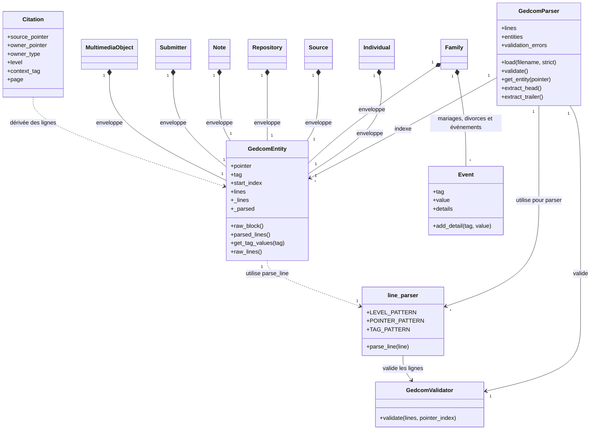

# Modèle de domaine GEDCOM

Structure du domaine : analyse, validation, indexation et modèles métier qui
enveloppent les enregistrements GEDCOM.

## Lecture

- `GedcomParser` est le point unique de lecture : il découpe les enregistrements,
  les indexe par pointeur et délègue la validation à `GedcomValidator`.
- `GedcomEntity` est une vue paresseuse sur les lignes : `lines` met en cache la
  tranche de l'entité, puis `raw_block()` et `parsed_lines()` s'appuient dessus.
  Les lignes malformées sont filtrées paresseusement lors du premier accès.
- Les modèles consomment `parsed_lines()` et exposent leurs champs optionnels via
  `_LazyList`. Les listes simples de tags (`FAMS`, `OBJE`, `PROP`, `NOTE`,
  contacts, références) passent par `gedcom.models.tag_values.get_tag_values()`
  afin de partager la fusion `CONT`/`CONC`.
- `Family` construit des `Event` pour `MARR`, `DIV` et `EVEN` ; `Citation` est une
  valeur dérivée des lignes d'un enregistrement et met en cache ses `details`.
  Les continuations `CONT`/`CONC` sont fusionnées dans le champ parent du détail.
- `Individual.notes` collecte les notes de tous les événements, pas seulement
  `BIRT`, `DEAT` et `CHR`. Les notes `DATA` d'une `Source` restent des notes et
  ne sont pas concaténées au texte `TEXT`.
- Les modèles `Repository`, `Submitter`, `Note` et `MultimediaObject` partagent
  `gedcom.models.section_parser.AdditionalLinesMixin` : une seule boucle sépare
  les champs de niveau 1, les sous-sections et les champs additionnels.
- Les champs additionnels sont créés par `gedcom.models.details.new_field()` et
  lus par `field_parts()`, point de conversion unique entre dictionnaire canonique
  et tuple `(tag, valeur, détails)`.
- Les sous-tags `BIRT.DATE`, `DEAT.AGE` ou `MARR.PLAC` passent par
  `gedcom.models.tag_values.last_subtag_value()`.

## Voir aussi

- [Architecture en couches](ARCHITECTURE.md)
- [Chargement asynchrone](ASYNC-LOADING.md)
