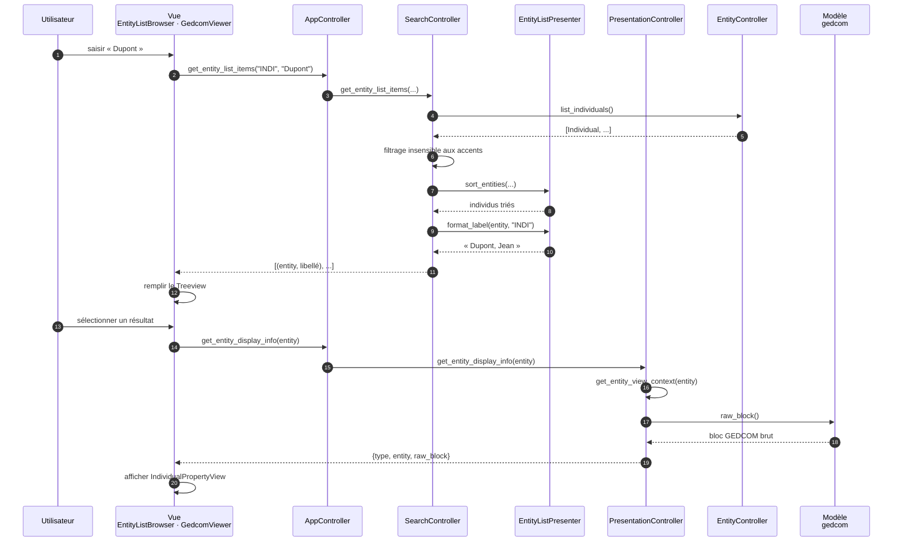

# Parcours MVP d'une requête

Déroulé d'une recherche suivie d'une sélection à travers les couches MVP.

## Requête

L'utilisateur saisit « Dupont » dans le champ de recherche, puis sélectionne
l'individu Jean Dupont.

## Déroulé

1. **Vue → façade** : `EntityListBrowser.filter_entities` diffère la recherche
   de 100 ms, puis `refresh_entities` appelle
   `AppController.get_entity_list_items("INDI", "Dupont")`
   (`EntityListBrowser.filter_entities`, `refresh_entities`).
2. **Façade → présentateur** : `AppController` délègue à
   `SearchController.get_entity_list_items`
   (`AppController.get_entity_list_items`, `SearchController.get_entity_list_items`).
3. **Présentateur → modèle** : `get_entity_list` → `search_entities` →
   `search_individuals` → `EntityController.list_individuals()`
   (`SearchController.get_entity_list`, `EntityController.list_individuals`).
4. **Filtrage** : `_normalize_search_text` rend la recherche insensible à la
   casse et aux accents (`SearchController._normalize_search_text`).
5. **Tri** : `EntityListPresenter.sort_entities` ordonne par pointeur numérique
   (`EntityListPresenter.sort_entities`).
6. **Formatage** : `EntityListPresenter.format_label` produit « Dupont, Jean »
   (`EntityListPresenter.format_label`).
7. **Retour à la vue** : la vue remplit le `Treeview` via
   `format_entity_display_name` (`EntityListView.update_items`).
8. **Sélection** : `GedcomViewer.show_entity` → `_show_selected_entity` →
   `AppController.get_entity_display_info(entity)`
   (`GedcomViewer.show_entity`, `_show_selected_entity`).
9. **Présentateur d'affichage** : `PresentationController.get_entity_display_info`
   calcule le contexte via `get_entity_view_context` et `get_raw_block`
   (`PresentationController.get_entity_display_info`, `get_entity_view_context`).
10. **Rendu** : `display_entity_context` → `EntityViewManager.show("individual",
    entity)` → `IndividualPropertyView.display(entity)`
    (`GedcomViewer.display_entity_context`, `EntityViewManager.show`).

## Rôles mobilisés

- **Modèle** : `gedcom/` (`GedcomEntity`, `Individual`).
- **Présentateurs** : `AppController` (façade), `SearchController`,
  `PresentationController`, `EntityListPresenter`, `EntityController`.
- **Vue** : `EntityListBrowser`, `GedcomViewer`, `EntityViewManager`,
  `IndividualPropertyView`.

## Voir aussi

- [Fonctionnement MVP](MVP.md)
- [Architecture en couches](ARCHITECTURE.md)
- [Chargement asynchrone](ASYNC-LOADING.md)
