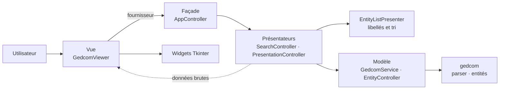

# Fonctionnement MVP

Présentation du patron Modèle-Vue-Présentateur (MVP) et du rôle de chaque couche
dans l'application.

## Rôles

| Rôle | Modules | Responsabilité |
| --- | --- | --- |
| Modèle | `gedcom/` | lire, valider et exposer les enregistrements GEDCOM |
| Présentateur | `controllers/` | orchestrer, rechercher, trier et formater |
| Vue | `ui/` | afficher les widgets et transmettre les actions |

## Déroulé d'une interaction

1. La vue (`GedcomViewer`) appelle la façade `AppController` ; les
   sous-composants y accèdent via un fournisseur (closure) et ne gardent pas de
   référence directe au contrôleur.
2. `AppController` délègue à `SearchController`, `PresentationController` ou
   `EntityController`.
3. Le présentateur interroge le modèle via `GedcomService` et `EntityController`,
   puis renvoie des données brutes : listes, libellés et contextes d'affichage.
4. `EntityListPresenter` assure le formatage des noms, des libellés et le tri.
5. La vue reçoit ces données et met à jour les widgets ; aucun contrôleur ne
   manipule de widget.
6. Après chargement, la vue publie le nouvel `AppController` notifié par
   `GedcomFileLoader`, ce qui permet le remplacement de session.

## Dépendances

- La vue principale connaît la façade `AppController` ; les contrôleurs
  spécialisés ne sont instanciés que par cette façade.
- Les contrôleurs ne touchent pas aux widgets et ne portent pas la logique de
  présentation.
- Le modèle ignore les couches supérieures.

## Voir aussi

- [Parcours MVP d'une requête](MVP-REQUEST.md)
- [Architecture en couches](ARCHITECTURE.md)
- [Modèle de domaine](DOMAIN-MODEL.md)
- [Chargement asynchrone](ASYNC-LOADING.md)
